  <picture>
    <source media="(prefers-color-scheme: dark)" srcset="https://raw.githubusercontent.com/skunk-werks/.github/main/profile/images/banner-dark.svg">
    <source media="(prefers-color-scheme: light)" srcset="https://raw.githubusercontent.com/skunk-werks/.github/main/profile/images/banner-light.svg">
    
  </picture>

Skunk Werks is a small R&D shop. Two engineers build software here, and we are quiet about which software.

## Operating principles

1. We ship on Friday. Monday is for finding out.
2. Staging is prod with fewer witnesses.
3. YAML is whitespace with consequences.

## FAQ

_What do you build?_\
Software.

_Can you be more specific?_\
Yes.

_Is the name a typo?_\
No. The cursor is parked on the E so people stop asking.

_Are you hiring?_\
There are two of us and the standup already runs long.

---

© 2026 Skunk Werks. All rights reserved.

